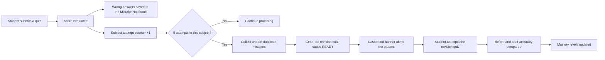

<div align="center">


# QuizHub

### Turn Every Mistake into Mastery

An AI-powered adaptive learning and quiz management app for Android, with separate **Student** and **Teacher** panels.


[Project Report (PDF)](https://github.com/abstracted-m7/MCA-25/blob/main/Android_Application/QuizHub/document/QuizHub-%20Turn_Every_Mistake_into_Mastery.pdf) ·
[Source Code](https://github.com/abstracted-m7/MCA-25/tree/main/Android_Application/QuizHub/QuizMania) ·
[Architecture Diagrams](https://github.com/abstracted-m7/MCA-25/tree/main/Android_Application/QuizHub/architectures)

</div>

---

## Table of Contents

- [About](#about)
- [Key Features](#key-features)
- [How the Adaptive Revision Works](#how-the-adaptive-revision-works)
- [Tech Stack](#tech-stack)
- [Architecture](#architecture)
- [Project Structure](#project-structure)
- [Getting Started](#getting-started)
- [Firebase Setup](#firebase-setup)
- [AI Quiz Generation Setup](#ai-quiz-generation-setup)
- [Documentation and Diagrams](#documentation-and-diagrams)
- [Roadmap](#roadmap)
- [Team](#team)
- [Acknowledgements](#acknowledgements)

---

## About

Most quiz apps tell you what you got wrong and move on. **QuizHub** remembers it.

Every wrong answer is stored, grouped by subject, and brought back to you in a personalised revision quiz after you complete **5 attempts in a subject**. Questions you keep missing are tracked through three mastery levels (Weak, Practicing, Mastered), so you can see your mistakes turn into strengths.

Teachers get their own panel to manage subjects, build quizzes, track students by roll number, and see where the whole class is struggling.

QuizHub was built as a Master of Computer Applications (MCA) project at Brainware University.

---

## Key Features

### Student Panel

| Feature | Description |
|---|---|
| **Authentication** | Email and password sign-up and login with role-based routing |
| **Subject-wise quizzes** | Browse subjects and topics, then attempt published quizzes |
| **Timed quiz engine** | Countdown timer set by the teacher, with auto-submit when time runs out |
| **Instant results** | Score, correct and wrong counts, and time taken as soon as you submit |
| **Answer review** | Full answer key with explanations, showing your answer next to the correct one |
| **AI quiz generator** | Generate a multiple-choice quiz on any topic using OpenRouter models |
| **Mistake Notebook** | Every wrong answer saved and tagged Weak, Practicing, or Mastered |
| **Adaptive revision** | A personalised revision quiz built from your mistakes after every 5 attempts in a subject |
| **Progress and analytics** | Subject-wise bar charts, accuracy, average score, and day streak |
| **Feedback** | Send feedback to the team from inside the app |

### Teacher Panel

| Feature | Description |
|---|---|
| **Subject and topic management** | Create and organise the curriculum |
| **Quiz builder** | Write questions with options A to D, the correct answer, and an explanation, then publish to students in one flow |
| **Question bank** | Questions are saved to a central bank and can be imported into new quizzes |
| **Student tracking** | Search a student by roll number (for example `BWU/MCA/25/040`) to see attempts, scores, and subject-wise performance |
| **Class analytics** | Class averages and the most frequently missed questions |

---

## How the Adaptive Revision Works



**Mastery levels** for each mistaken question:

| Level | Meaning |
|---|---|
| Weak | Not yet answered correctly in revision |
| Practicing | Answered correctly once in revision |
| Mastered | Answered correctly twice in revision |

After a revision quiz, QuizHub reports the improvement as a change in accuracy points (accuracy after minus accuracy before).

---

## Tech Stack

| Layer | Technology |
|---|---|
| **Language** | Java 11, XML layouts with View Binding |
| **Platform** | Android (minSdk 24, targetSdk 34) |
| **Architecture** | MVVM with Repository and Service layers |
| **Authentication** | Firebase Authentication (email and password) |
| **Database** | Cloud Firestore, protected by [security rules](https://github.com/abstracted-m7/MCA-25/blob/main/Android_Application/QuizHub/QuizMania/firestore.rules) |
| **AI** | OpenRouter API (free models: Auto, Llama 3 8B, Mistral 7B) |
| **Networking** | Retrofit, Gson, RxJava 3 |
| **UI** | Material Components, ConstraintLayout, custom Canvas bar chart |
| **Optional backend** | Python Cloud Function that proxies OpenRouter requests |
| **Tools** | Android Studio, Figma |

---

## Architecture

```
┌────────────────────────────────────────────────────────────┐
│  View          Activities and XML layouts                  │
│                (student/, teacher/, view/)                 │
├────────────────────────────────────────────────────────────┤
│  ViewModel     AuthViewModel, DashboardViewModel,          │
│                AiQuizViewModel, QuizEngineViewModel        │
├────────────────────────────────────────────────────────────┤
│  Services      QuizEvaluationService,                      │
│                AdaptiveLearningService,                    │
│                ProgressCalculationService                  │
├────────────────────────────────────────────────────────────┤
│  Repository    Auth, Subject, Question, Quiz,              │
│                Student, AdaptiveLearning, AiQuiz           │
├──────────────────────────────┬─────────────────────────────┤
│  Firebase Auth + Firestore   │  OpenRouter AI (Retrofit)   │
└──────────────────────────────┴─────────────────────────────┘
```

### Firestore collections

`users` · `subjects` · `topics` · `questions` · `quizzes` · `quizAttempts` · `wrongAnswers` · `learningProgress` · `revisionQuizzes` · `revisionAttempts`

See the [ER diagram](https://github.com/abstracted-m7/MCA-25/blob/main/Android_Application/QuizHub/architectures/QuizHub-ER-Diagram.pdf) for how they relate.

---

## Project Structure

```
QuizHub/
├── QuizMania/                  # Android Studio project
│   ├── app/src/main/
│   │   ├── java/com/example/quizmania/
│   │   │   ├── model/          # User, Subject, Topic, Question, Quiz, QuizAttempt,
│   │   │   │                   # WrongAnswer, LearningProgress, RevisionQuiz, ...
│   │   │   ├── student/        # Quiz attempt, results, review, mistake notebook,
│   │   │   │                   # revision, progress
│   │   │   ├── teacher/        # Subjects, quiz builder, student tracking, analytics
│   │   │   ├── view/           # Launch, auth, dashboards, AI quiz, feedback
│   │   │   ├── viewmodel/      # MVVM view models
│   │   │   ├── repository/     # Firestore and AI data access
│   │   │   ├── services/       # Evaluation, adaptive learning, progress logic
│   │   │   ├── network/        # Retrofit client and OpenRouter service
│   │   │   ├── adapters/       # RecyclerView adapters
│   │   │   ├── ui/             # Custom views (SubjectBarChartView)
│   │   │   └── util/           # SessionManager, EmailSender
│   │   └── res/                # Layouts, drawables, themes
│   ├── functions/              # Optional Python Cloud Function (OpenRouter proxy)
│   └── firestore.rules         # Firestore security rules
├── architectures/              # Flowcharts, ER diagram, Gantt chart
├── document/                   # Full project report (PDF)
├── logo/                       # QuizHub logo
└── output/                     # Firebase Authentication console screenshot
```

---

## Getting Started

### Prerequisites

- [Android Studio](https://developer.android.com/studio) (latest stable)
- JDK 11 or newer
- An Android device or emulator running Android 7.0 (API 24) or higher
- A Firebase project (see [Firebase Setup](#firebase-setup))
- An [OpenRouter](https://openrouter.ai/) API key (only needed for AI quiz generation)

### Run the app

1. **Clone the repository**
   ```bash
   git clone https://github.com/abstracted-m7/MCA-25.git
   cd MCA-25/Android_Application/QuizHub/QuizMania
   ```

2. **Open the `QuizMania` folder in Android Studio** and let Gradle sync.

3. **Add your OpenRouter key** to `local.properties` in the `QuizMania` folder. This file is git-ignored.
   ```properties
   OPENROUTER_API_KEY=your_openrouter_key_here
   ```

4. **Connect your own Firebase project** (next section).

5. **Run** the `app` configuration on a device or emulator, or build a debug APK:
   ```bash
   ./gradlew assembleDebug        # macOS / Linux
   gradlew.bat assembleDebug      # Windows
   ```
   The APK is created at `app/build/outputs/apk/debug/app-debug.apk`.

---

## Firebase Setup

1. Create a project in the [Firebase Console](https://console.firebase.google.com/).
2. Add an Android app with the package name `com.example.quizmania`.
3. Download `google-services.json` and place it in `QuizMania/app/`.
4. Enable **Authentication → Email/Password**.
5. Create a **Cloud Firestore** database.
6. Publish the rules from [`firestore.rules`](https://github.com/abstracted-m7/MCA-25/blob/main/Android_Application/QuizHub/QuizMania/firestore.rules).

The rules give students access only to their own attempts and mistakes, while teachers can manage content and read class-wide data.

---

## AI Quiz Generation Setup

The app calls OpenRouter directly using the key from `local.properties`, which is compiled into the app through `BuildConfig`. That is fine for local development, but **a key inside an APK can be extracted**. For anything beyond a demo, route requests through the included Cloud Function instead:

- Source: [`QuizMania/functions/main.py`](https://github.com/abstracted-m7/MCA-25/blob/main/Android_Application/QuizHub/QuizMania/functions/main.py) (Flask, exposes `/generateQuiz` and `/generateRevisionQuiz`)
- Set `OPENROUTER_API_KEY` as an environment variable on the deployed function, so the key never ships with the app.

---

## Documentation and Diagrams

| Resource | Link |
|---|---|
| Full project report | [QuizHub – Turn Every Mistake into Mastery (PDF)](https://github.com/abstracted-m7/MCA-25/blob/main/Android_Application/QuizHub/document/QuizHub-%20Turn_Every_Mistake_into_Mastery.pdf) |
| Combined app flow | [Combine-App-Flow-Architecture.pdf](https://github.com/abstracted-m7/MCA-25/blob/main/Android_Application/QuizHub/architectures/Combine-App-Flow-Architecture.pdf) |
| Student panel flowchart | [Student-Panel-Flowchat.pdf](https://github.com/abstracted-m7/MCA-25/blob/main/Android_Application/QuizHub/architectures/Student-Panel-Flowchat.pdf) |
| Teacher panel flowchart | [Teacher-Panel-Flowchat.pdf](https://github.com/abstracted-m7/MCA-25/blob/main/Android_Application/QuizHub/architectures/Teacher-Panel-Flowchat.pdf) |
| ER diagram | [QuizHub-ER-Diagram.pdf](https://github.com/abstracted-m7/MCA-25/blob/main/Android_Application/QuizHub/architectures/QuizHub-ER-Diagram.pdf) |
| Project schedule | [Gantt chart](https://github.com/abstracted-m7/MCA-25/blob/main/Android_Application/QuizHub/architectures/gnatt-chart.png) |

UI screenshots for every screen are in **Chapter 8 (Experimental Results)** of the project report.

---

## Roadmap

Planned in the project report, not yet implemented:

- [ ] Leaderboard
- [ ] Real-time multiplayer quiz competitions
- [ ] Easy / medium / hard difficulty levels with adaptive difficulty
- [ ] Offline practice mode
- [ ] Push notifications and daily quiz reminders
- [ ] Deeper topic-wise analytics

---

## Team

Department of Computational Sciences, **Brainware University**, Kolkata
Master of Computer Applications (MCA)

| Name | Student Code |
|---|---|
| Avik Mondal | BWU/MCA/25/038 |
| [Manish Giri](https://github.com/abstracted-m7) | BWU/MCA/25/040 |
| Rinki Saha | BWU/MCA/25/041 |

**Project guide:** Mr. Samrat Kundu

---

## Acknowledgements

- [Firebase](https://firebase.google.com/) for authentication and Cloud Firestore
- [OpenRouter](https://openrouter.ai/) for access to AI models
- [Retrofit](https://square.github.io/retrofit/) and [Gson](https://github.com/google/gson)
- Brainware University, for the opportunity to build this project

---

<div align="center">

If QuizHub helped you, consider giving the repo a ⭐

</div>
